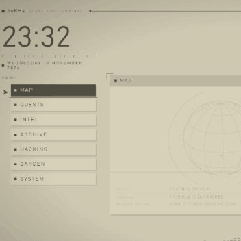

# YoRHa Terminal

A fan-made NieR:Automata style desktop terminal for [Wallpaper Engine](https://store.steampowered.com/app/431960/Wallpaper_Engine/). It is plain HTML, CSS and canvas, with no game assets.



**[Try the live demo](https://calebfrums.github.io/yorha-terminal/)** · **[Subscribe on the Steam Workshop](https://steamcommunity.com/sharedfiles/filedetails/?id=3830732662)**

> Not affiliated with Square Enix. NieR:Automata and its characters belong to their owners.

## The hub and its places

The desktop is the hub. Hover a menu entry to preview it and click to go there. HUB brings you back, and the terminal also returns on its own when idle.

| Place | What's there |
| --- | --- |
| **MAP** | Drag the globe and click locations to survey them |
| **QUESTS** | Time progress, your own daily orders checklist, a focus timer |
| **INTEL** | Now playing, an audio log and the Pod archive |
| **ARCHIVE** | A character grid. Click a record to put it on the desktop |
| **HACKING** | BREACH, a 3D intrusion drill built on three.js. Also INTERCEPT, LOGIC LOCK and your records |
| **GARDEN** | Plant Lunar Tears and stir the wind with the cursor |
| **SYSTEM** | Diagnostics and quick settings you can change from the desktop |

## Features

- A live clock and date in the YoRHa menu style
- An audio visualizer and floating particles, with scanlines and glitches
- A Pod log with about 210 lines that react to the time, the music and what you do (try petting the Pod: move in slow circles over its log)
- Daylight, night or automatic theme, which switches by the clock
- Menu on the left or right. It works on ultrawide and portrait monitors
- Your own image or `.webm` video as a duotone background
- Characters from a folder of your PNGs. They stand beside the panel, breathe, emote, say your custom lines and react to clicks
- 9 languages: English, 简体中文, 日本語, 한국어, Русский, Deutsch, Français, Español, Português (Brasil)

## Demo notes

The demo runs the same files Wallpaper Engine does, but in a browser. Some parts need Wallpaper Engine:

- The visualizer shows simulated levels. Live audio and INTEL's now playing need Wallpaper Engine's audio and Media Integration feeds
- Property changes come from its settings panel. In the browser, use SYSTEM > QUICK SETTINGS, or URL hash keys:

```
#theme=dark                  light | dark | auto
#language=ja                 auto | en | zh | ja | ko | ru | de | fr | es | pt
#place=hacking               map | quests | intel | archive | hacking | garden | system
#layout=right&uiscale=110
#charfiles=https://example.com/a.png|https://example.com/b.png
```

This repo does not include character images. The Workshop version includes a character set, and you can set **Character folder** to your own PNG renders. The file name becomes the on-screen name, so `01 - 2B - YoRHa No.2 Type B.png` shows 2B with that subtitle. Tall transparent PNGs (600 px or more) stand on the desktop. Other images appear only in ARCHIVE.

## Running it locally

Open `index.html` in a browser, or serve the folder:

```
npx serve .
```

To use it in Wallpaper Engine, subscribe on the Workshop. Or open the editor, create a web wallpaper and point it at `index.html`.

## Files

| Path | Purpose |
| --- | --- |
| `index.html`, `style.css`, `main.js` | The terminal, its panels, places and settings |
| `games.js`, `breach3d.js` | HACKING drills (BREACH uses `vendor/three.min.js`, MIT) |
| `podlines.js` | The Pod's dialogue banks |
| `i18n.js`, `i18n/*.txt`, `lang/*.js` | Translations. Edit `i18n/<code>.txt`, then run `node tools/build_i18n.mjs` |
| `project.json` | Wallpaper Engine project and its properties |
| `tools/` | Dev helpers: translation build, the preview GIF capture, the BREACH test page |
